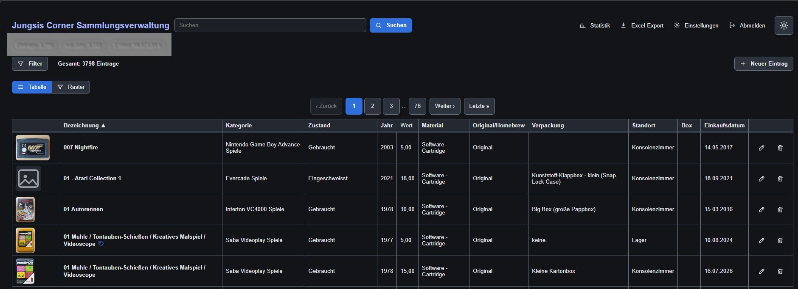
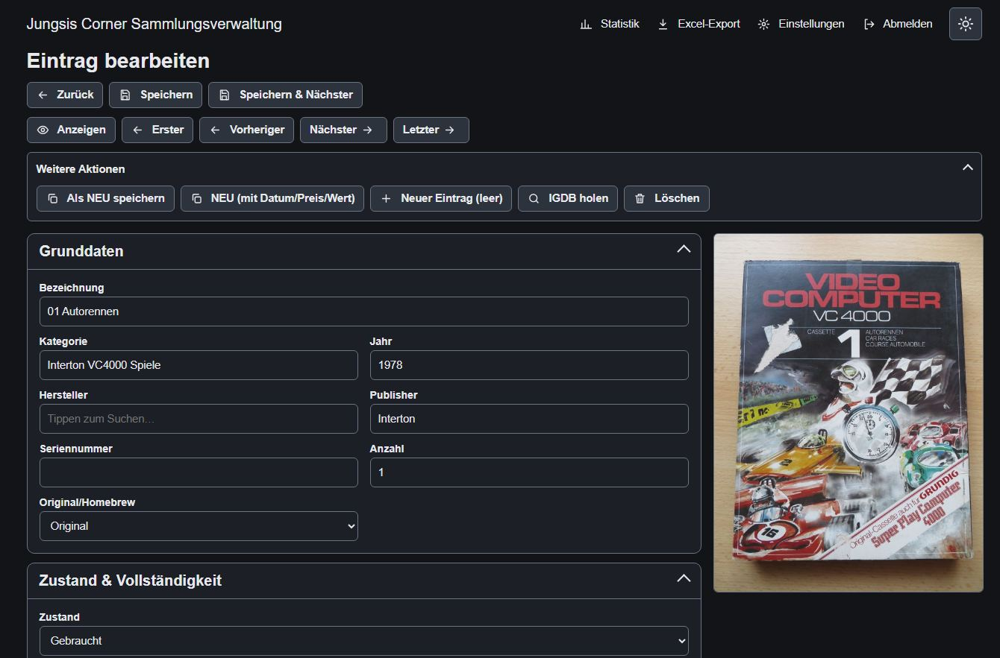
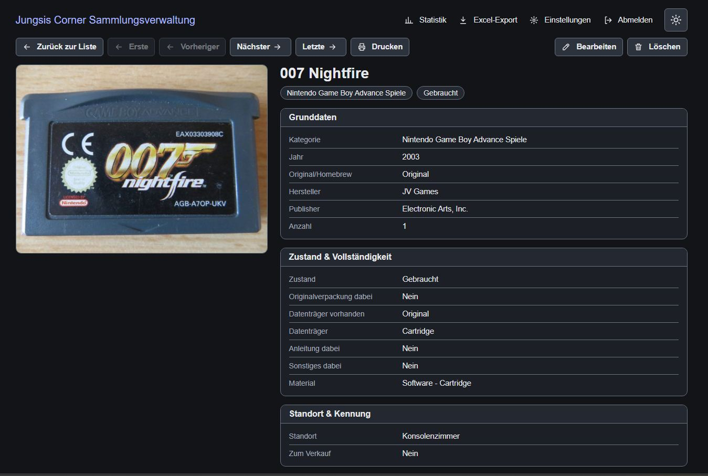
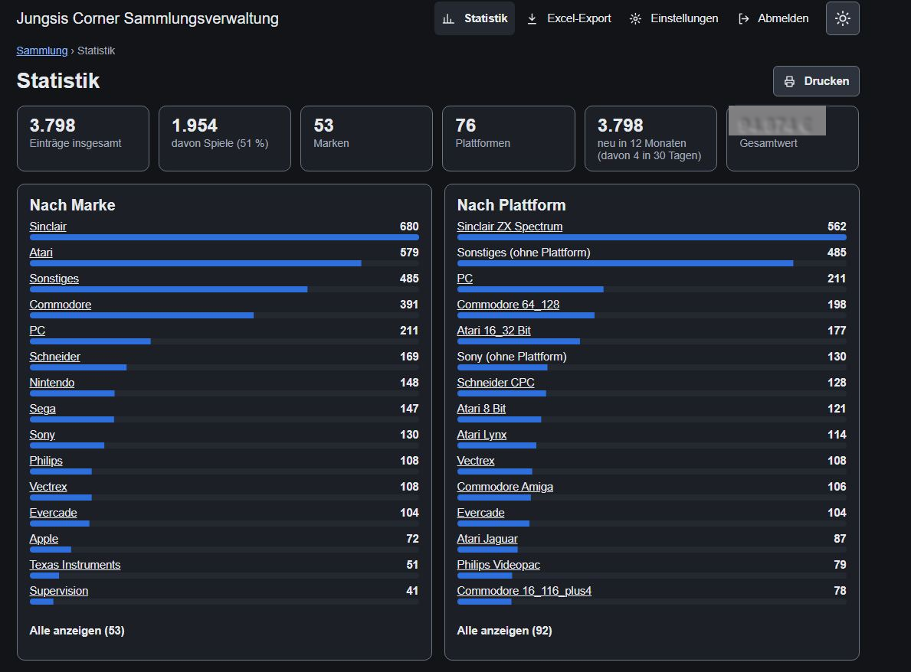

# Sammlungsdatenbank

Eine selbstgebaute Web-Anwendung (PHP/MySQL) zur Verwaltung einer physischen Sammlung – ursprünglich für eine Retro-Computing-/Gaming-Sammlung mit über 1.300 Objekten entwickelt (Heimcomputer, Konsolen, Handhelds, Spiele, Zubehör, Literatur).

📖 Hintergrund & Entwicklungs-Changelog: [jungsi.de/datenbank-changelog](https://www.jungsi.de/datenbank-changelog/)

## Screenshots

| Listenansicht | Bearbeiten |
|---|---|
|  |  |

| Detailansicht | Statistik |
|---|---|
|  |  |

<!-- Bilder einfach als index.png / edit.png / view.png / statistik.png in docs/screenshots/ ablegen, dann werden sie hier automatisch angezeigt. -->

## Was kann die App?

- **Für Handy, Tablet und Desktop gebaut:** Liste als Karten, Raster oder Tabelle je nach Bildschirmbreite, Filter als Seitenleiste bzw. Bottom-Sheet, untere Navigation auf dem Handy, Wischen zwischen Einträgen, Hell-/Dunkelmodus, Druckansicht für Detail, Liste und Statistik. Installierbar als **PWA** mit Offlineseite.
- **Barrierefrei bedienbar** (Tastatur, Screenreader, Kontraste nach WCAG AA, 200 % Zoom); geprüft mit axe-core.
- Vollständige CRUD-Verwaltung von Sammlungsobjekten (Bezeichnung, Kategorie, Hersteller, Zustand, Vollständigkeit, Standort, Kaufdaten, Testdaten, uvm.)
- Trennung von **Erhaltungszustand** und **Vollständigkeit** (Original/Nachdruck je Komponente: Verpackung, Anleitung, Datenträger)
- Verknüpfung zusammengehöriger Objekte (z. B. eingebautes Zubehör oder separat gelagerte Handbücher) über „Gehört zu"
- Automatischer Import von Spielbeschreibungen über die [IGDB-API](https://api-docs.igdb.com/) inkl. optionaler automatischer Übersetzung (DeepL)
- Barcode-Scan per Kamera (Handy/Tablet) zur schnellen Erfassung
- **Bilder** mit Miniaturen (`thumb.php`); entweder aus einer WordPress-Mediathek neben der App oder **ohne WordPress** mit Upload und Auswahl im Bearbeiten-Formular (siehe [Bilder](#bilder-ohne-wordpress))
- Suchfelder mit Vorschlagsliste statt langer Auswahllisten (auch bei tausenden Einträgen schnell)
- Einkaufslisten-Verwaltung (`einkauf.php`) mit Filtern, Stand-Schaltern (Foto, DB, Web), Kickstarter-Lieferdatum und Direktübernahme in die Sammlung
- Gast-Modus (Nur-Lese-Ansicht ohne sensible Felder wie Wert/Einkaufspreis, siehe [Gastzugang](#gastzugang))
- CSV-Export der aktuell gefilterten/sortierten Liste (mit Hinweis auf die aktiven Filter; für Gäste standardmäßig aus)
- **Kategorie-Hierarchie** (Marke → Plattform → Spiele/Anwendungen): Filter „inkl. Unterkategorien“ (z. B. alles von Sinclair), Baum in der Kategorie-Auswahl und eigene Pflegeseite
- **Stammdaten-Pflege** (Hersteller, Publisher, Verkäufer, Material, Standort, Box, …) mit Schutz vor Dubletten, Anzeige der Verwendung und Zusammenführen doppelter Einträge
- **Boxen** als eigene Stammdaten („Box 1“, „Regal“) statt freier Zahl, mit Filter und Anzeige in Liste, Detail und Export
- Statistik-Seite mit Verteilungen nach Marke, Plattform, Typ (Spiele/Anwendungen/Hardware), Material und Jahr sowie Gesamtwert
- **Museum-Modus** (`museum/start.php`, der ältere Kurzlink `museum/index.php` leitet dorthin weiter): Ein Kurzlink, der Besucher automatisch als Gast einloggt und direkt zur Sammlung weiterleitet – gedacht für den Vor-Ort-Einsatz, z. B. per QR-Code an einem Regal oder einer Vitrine (siehe auch `go.php` für numerische Kurzcodes zu gefilterten Ansichten). Kein Passwort nötig, da nur Lesezugriff.
- **Verkaufsmarkierung**: Duplikate/Mehrfachexemplare lassen sich als „Zum Verkauf“ kennzeichnen, inkl. Schnellfilter in der Listenansicht.
- **Bildprüfung** (`bildpruefung.php`): fehlende Dateien, große Originale, verwaiste Dateien, Status von GD und Upload-Limit.
- **Admin-Log-Viewer** (`logview.php`): Die letzten Zeilen des PHP-Error-Logs direkt im Browser einsehen, ohne FTP-Zugriff – mit einfacher Passwort-/Token-Maskierung.

## ⚠️ Wichtig, bevor du startest

Dieses Projekt ist **aus einem konkreten, persönlichen Anwendungsfall gewachsen** – nicht als generisches, sofort einsatzbereites Produkt geplant. Konkret bedeutet das:

- Feldnamen und Oberfläche sind **auf Deutsch** und an eine Retro-Computing-Sammlung angepasst (z. B. „Datenträger", „Verpackung", „Original/Homebrew"). Für andere Sammelgebiete musst du Felder/Kategorien anpassen.
- Getestet auf klassischem Shared-Hosting (Apache + PHP + MySQL). Für andere Umgebungen (nginx, Docker, …) sind ggf. Anpassungen an `.htaccess` nötig.
- Die PWA-Konfiguration (`sw.js`) enthält fest eincodierte Pfade (`/sammlung/…`), die beim Fork an den eigenen Installationsort angepasst werden müssen.
- Anwendungstitel, Museum-Titel und PWA-App-Name sind zentral in `config.php` als `APP_TITLE`, `APP_TITLE_MUSEUM`, `APP_PWA_NAME` und `APP_PWA_SHORT_NAME` definiert (`manifest.php` und `index.php` lesen diese Werte automatisch aus).
- Tests: Skripte in [`tests/`](tests/README.md) (Smoke-Test, Filter-Gleichheit, Datenbankprüfungen) laufen lokal gegen eine Testkopie mit Wegwerf-Datenbank. Es gibt kein Test-Framework; die manuelle Abnahme steht in `docs/abnahme.md`.
- Geldbeträge werden als `DECIMAL(10,2)` gespeichert, die Eingabe akzeptiert Komma oder Punkt (`inc_format.php`).

Betrachte es als **Vorlage zum Forken und Anpassen**, nicht als fertiges Produkt zum 1:1-Deployen.

## 🔒 Sicherheitshinweise

- **Admin-Passwort sofort selbst setzen** – den Hash in `config.php` niemals aus einer Anleitung/einem Beispiel übernehmen, siehe Setup-Schritt 2.
- `config.php` niemals committen (ist per `.gitignore` bereits ausgeschlossen) – sie enthält Datenbank-Zugangsdaten, API-Keys und den Admin-Passwort-Hash.
- Bevor du eigene Debug-/Testskripte im Projektordner ablegst (z. B. um mal eben eine API oder einen Datenbank-Query auszuprobieren): entweder mit `is_admin()` absichern wie `logview.php`, oder nach Gebrauch konsequent wieder löschen. Unauthentifizierte Skripte mit Datenbankzugriff oder fest eincodierten Zugangsdaten sind ein leicht vermeidbares, aber ernstes Risiko.
- Bei Secrets, die versehentlich committet wurden: nicht nur die Datei löschen, sondern das jeweilige Secret beim Anbieter widerrufen/neu generieren (der alte Wert bleibt sonst in der Git-Historie sichtbar) und bei Bedarf die Git-Historie bereinigen.

### Gastzugang

Der Gastzugang ist **bewusst öffentlich**: Der Login `gast` / `gast` sowie der Link `login.php?autologin=gast` (und der Museum-Link) geben nur Lesezugriff. Wer den Quelltext liest, kennt die Zugangsdaten – das ist gewollt und kein Sicherheitsrisiko, solange Gäste nichts ändern und keine privaten Daten sehen. Deshalb gilt für Gäste:

- Kein „Bearbeiten“-Link und kein „Erstellt am“/„Geändert am“ im HTML; der Logout-Link heißt „Zur Anmeldung“.
- Felder wie Standort, Box, Einkaufspreis, Wert und Getestet bleiben verborgen. Die Liste steht in `config.php` (`GUEST_HIDDEN_FIELDS`, Vorlage in `config.example.php`) und lässt sich z. B. um `Seriennummer`, `Verkäufer` oder `Einkaufsdatum` erweitern.
- Der Export ist für Gäste aus (`GUEST_EXPORT_ENABLED = false`). Wer ihn einschaltet, begrenzt ihn mit `GUEST_EXPORT_MAX_ROWS` (Standard 200 Zeilen).
- Der Gast-Login ist von der Login-Drosselung ausgenommen. Gast-Logins werden pro neuer Gast-Session gezählt (Statistik-Seite, nur für Admins).

### Session-Cookie (wichtig bei bestehenden Installationen)

Die Cookie-Domain der Session kommt aus `SESSION_COOKIE_DOMAIN` in `config.php`. Leer bedeutet: nur der eigene Host (richtig für Neuinstallationen ohne Subdomain). Läuft die App schon und haben Nutzer ein Session-Cookie mit Domain (z. B. `.example.org`), **muss derselbe Wert in `config.php` stehen, bevor `boot.php` hochgeladen wird**. Sonst entstehen zwei gleichnamige Cookies, der Browser schickt das alte zuerst, und die Anmeldung läuft scheinbar ohne Fehlermeldung ins Leere, bis die Cookies gelöscht sind. Admins werden nach `SESSION_ADMIN_IDLE` Sekunden Inaktivität abgemeldet (Standard 8 Stunden).

## Setup

1. Repository klonen:
   ```
   git clone https://github.com/DEIN-NAME/sammlungsdatenbank.git
   ```
2. `config.example.php` zu `config.php` kopieren, eigene Datenbank-Zugangsdaten eintragen und ein Admin-Passwort per `php -r "echo password_hash('DEIN-PASSWORT', PASSWORD_DEFAULT);"` erzeugen (Ergebnis in `ADMIN_PASSWORD_HASH` eintragen).
3. Datenbankschema importieren (`schema.sql`, z. B. über phpMyAdmin → Importieren). Sie enthält schon alle Migrationen und markiert sie als eingespielt.
4. Auf einem PHP-fähigen Webserver bereitstellen. Die App geht vom Ordner `/sammlung/` aus (Pfade in `sw.js`, `manifest.php` und den Seiten); liegt sie woanders, diese Pfade anpassen (Suche nach `/sammlung/`).
5. Schreibrechte für `cache/` (Miniaturen) und, wenn du Bilder hochladen willst, für `medien/` (siehe [Bilder](#bilder-ohne-wordpress)).

### Bilder (ohne WordPress)

Standardmäßig liegen die Bilder im Upload-Ordner einer WordPress-Installation neben der App (`IMAGE_SOURCE` = `wordpress`). **Ohne WordPress** trägst du in `config.php` ein:

```php
define('IMAGE_SOURCE', 'local');          // Bilder liegen im Ordner medien/ der App
define('IMAGE_UPLOAD_ENABLED', true);     // Upload im Bearbeiten-Formular
```

Dann gibt es im Bearbeiten-Formular unter dem Bildfeld die Knöpfe „Bild hochladen“ (auf dem Handy mit Kamera oder Fotos) und „Aus vorhandenen wählen“. Der Ordner `medien/` muss für den Webserver beschreibbar sein, PHP braucht die Erweiterung GD. Hochgeladene Bilder werden geprüft, gedreht und auf höchstens 2400 Pixel Kantenlänge verkleinert; Metadaten wie GPS-Daten fallen weg. Die Admin-Seite „Bildprüfung“ zeigt, was der Server erlaubt (Upload-Limit, GD). Der Modus `auto` sucht erst in `medien/` und dann bei WordPress (praktisch beim Umstieg). Bilder gehören nicht ins Git-Repository (`medien/` ist ausgeschlossen).

### Sicherheitsheader (`.htaccess`)

Die `.htaccess` setzt strenge Sicherheitsheader: eine Content-Security-Policy **ohne `unsafe-inline`** (alle Seiten kommen ohne Inline-CSS und -JS aus; neuer Code darf keine Inline-Stile, `onclick` oder Inline-Skripte enthalten), `X-Frame-Options`, `Referrer-Policy`, eine Permissions-Policy (Kamera nur für die App) und HSTS. Bilder von fremden `https`-Adressen sind erlaubt; der Barcode-Fallback lädt eine Bibliothek von `unpkg.com`. **HSTS** steht auf einem Jahr (`max-age=31536000`, ohne `includeSubDomains`). Das gilt für die ganze Domain; sorge vorher dafür, dass alles darunter über `https://` erreichbar ist, oder setze den Wert in der `.htaccess` kleiner (z. B. `300`).

### Bestehende Installation aktualisieren

Schemaänderungen liegen als nummerierte SQL-Dateien in [`migrations/`](migrations/README.md) und werden der Reihe nach in phpMyAdmin eingespielt (vorher Dump ziehen). Die Tabelle `schema_migrations` zeigt, welche schon gelaufen sind. Reihenfolge von Code-Upload und Migration, Wartungsmodus (`maintenance.flag`) und Rückbau (`DOWN`) stehen in `migrations/README.md`.

## Voraussetzungen

- PHP 8.1+ (der Code verlässt sich darauf, dass `mysqli` Fehler als Ausnahmen meldet; produktiv läuft PHP 8.4)
- MySQL 8.0 (so getestet; MariaDB ist ungetestet)
- Apache mit `.htaccess`-Unterstützung (`AllowOverride`; `mod_headers`, `mod_deflate`, `mod_expires` und `mod_rewrite` sind optional. `mod_headers` liefert die Sicherheitsheader, `mod_rewrite` trennt die App von Rewrite-Regeln im Webroot, z. B. WordPress)
- PHP-Erweiterungen: `mysqli`, `mbstring`, `fileinfo`; **GD** für Miniaturen und Bild-Upload, `exif` (optional) dreht Handyfotos richtig
- Optional: kostenloser [Twitch-Developer-Account](https://dev.twitch.tv/console/apps) für IGDB-Import, [DeepL-API-Key](https://www.deepl.com/de/pro-api) für automatische Übersetzung

## Lizenz

MIT – siehe [LICENSE](LICENSE). Nutzung, Anpassung und Weiterverbreitung ausdrücklich erwünscht.

## Danksagung

Ein Großteil der Weiterentwicklung entstand mit Unterstützung von [Claude](https://claude.com) (Anthropic).
